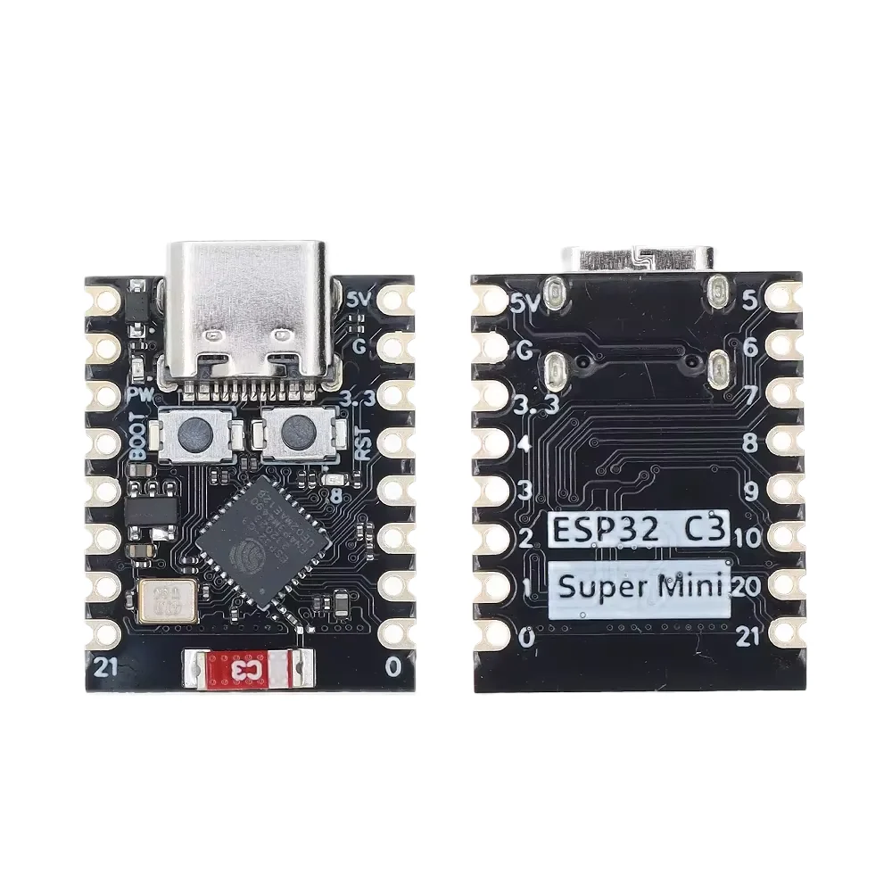
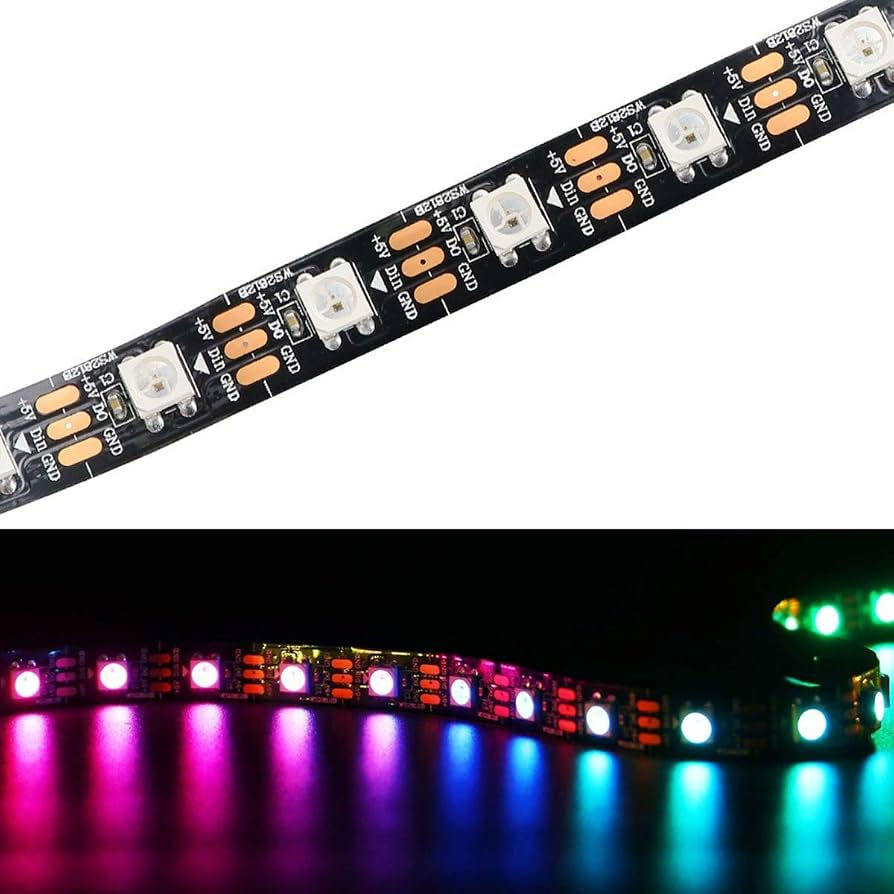
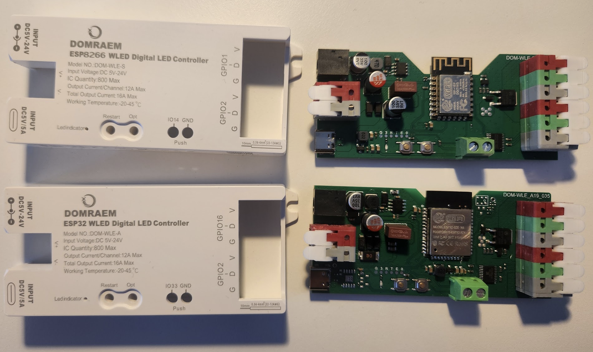

# WLED Workshop - BSides Sydney

This workshop will help you get up an running with the WLed project as an accessible, graphical means of networking, designing and controlling pretty colored addressable LEDs.

## What is WLED?

WLED is an open-source project that turns ESP32 and ESP8266 boards into Wi-Fi controllers for addressable LED lighting. You can use it to customise colours and animations, save presets, and control different sections of a strip independently. It works through a web interface and integrates with Home Assistant, making it suitable for everything from a single accent strip to a synchronised lighting display. WLED Project

## Starter Pack
You will be supplied a starter pack containing:

- ESP32-C3 supermini (Closest reference: [randomnerdtutorials](https://randomnerdtutorials.com/getting-started-esp32-c3-super-mini/))

  

- M-F Dupont Cables
- 8x8 Matrix of WS2812B Leds OR 1m strip of WS2812B Leds 60LED/M ([Datasheet](https://cdn-shop.adafruit.com/datasheets/WS2812B.pdf)) 

  
  

## What software tools do I need?

A web browser.

[https://kno.wled.ge/basics/getting-started/](https://kno.wled.ge/basics/getting-started/)

There are ways for you to build your own, but the browser is fairly straightforward.

Esptools via a python package is always useful if you needed to wipe an ESP's existing firmware. [https://github.com/espressif/esptool/](https://github.com/espressif/esptool/)

## Demonstration Wiring

How we will connect up the LED to the ESP is *NOT* best practice, and there are may guides available if more serious lighting ventures are to be had.

Be sure to have flashed WLED onto the ESP32, and setup wifi / other safety configurations, like current limiting before hooking up high draw LEDs.

### Electrically Questionable things we will overlook.
- **Digital Logic Levels**:
As the WS2812 chips are powered off a 5V supply, and the esp32 operates at a logic level of 3.3V. We do not technically meet the required input voltage specified in the LED datasheet. But it still works and we would have needed more stuff like level shifters, or another hack with a diode on the supply to drop the supply voltage.

- **USB Supply Current limits**:
USB 2.0 specifies that a maximum current of 500 mA (0.5 A) at 5 V, and with longer strings of LEDs, or in darker environments, we need to be careful not to draw too much current from a regular pc usb port. We will use the software current limiter within WLED as a precaution.

- **Space for Capacitors**:
The 1m strip of WS2812b chips have space for capacitors, but are not included. There is online speculation that some of the WS2812 chips have integrated decoupling, or not. Regardless they still work.

### Demo Wiring Diagram
In this example, the supplied 3 wire M-F connector should map as follows:
| WS2812B Wires | ESP32-C3 Pins |
| ---------- | -------- |
| V+ (V, for power) | 5V (Unregulated 5V USB supply) |
| Din               | 4  (GPIO4) Default for WLED, but configurable|
| V- (Ground)       | G (ESP32 and USB Ground) |

## Home Assistant integration

While we did not demo this during the workshop, as you need a prior HomeAssistant (HA) instance, Home assistant would have autodiscovery of WLED devices on the wame network.

[https://kno.wled.ge/advanced/home-automation/](https://kno.wled.ge/advanced/home-automation/)
[https://www.home-assistant.io/integrations/wled/](https://www.home-assistant.io/integrations/wled/)

## In room test network (No internet)

SSID: `WLED-TestNet`

Pass: `BsidesSydney`

# What Next?

Use the kit as you would Lego, you don't need to follow these instructions, and ESPs prove to be endlessly versatile.

For some ideas of what you might want to pursue next.

## More LEDs

I have shown off a 16x16 matrix, but Wled also supports HUB75 panels, which are even larger.

## Audio Reactivity

If you can source a microphone and look it up to the ESP, WLED supports lighting that reacts to audio.

## Less DIY options?

Some chinese sellers have begun to manufacture shell housings, and convenient connectors based on an underlying ESP32/ESP8266, they may be a useful alternative.

The samples pictured below, and what I will talk about does not include any power regulation circuitry. This is relegated to another external device.

  
